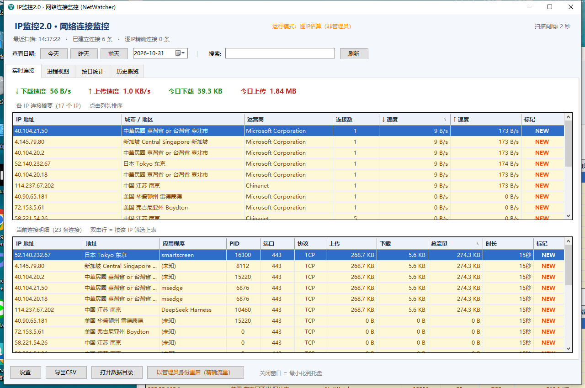
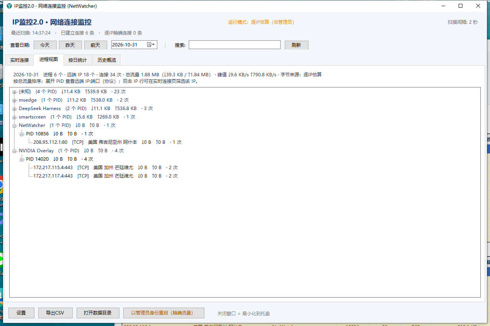
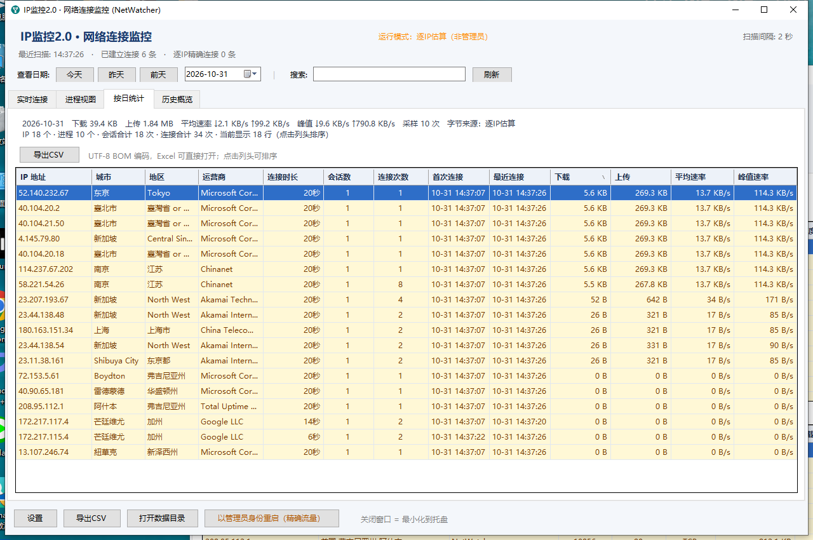
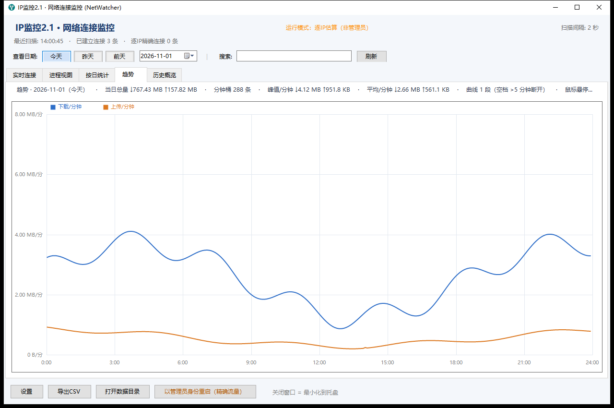
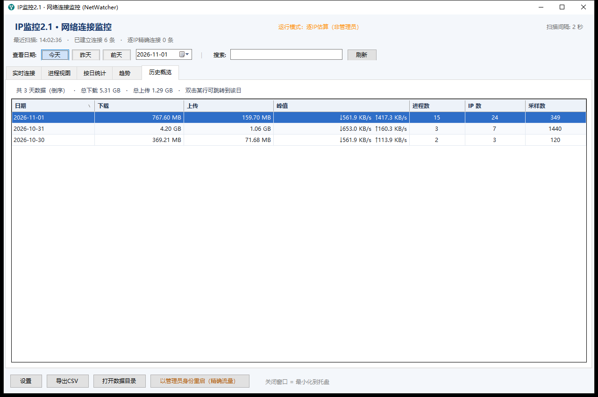
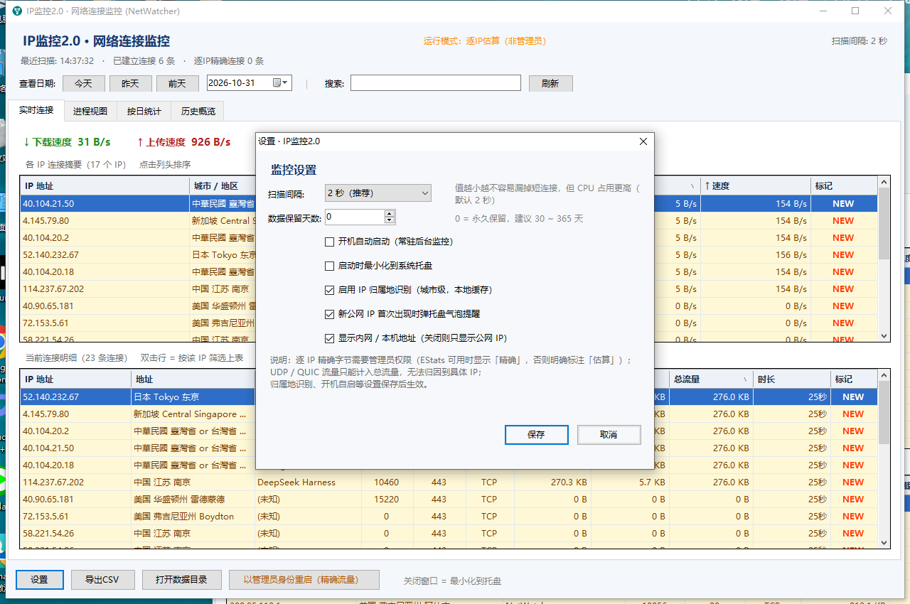

# IP监控2.1（NetWatcher）用户手册

> 适用版本：**IP监控2.1 · 网络连接监控（NetWatcher）**，版本号 **2.3.0 定版（2026-11-01；加密小时文件存储：数据加密、按小时落盘、升级需备份、迁移不可逆）**
> 适用对象：想在 Windows 上看清"这台电脑在跟哪些 IP 通信、流量花在谁身上"的普通用户。
> 阅读建议：第一次用请按顺序看第 1～4 章；已经装好只想查东西，直接看第 4 章"常见任务"；遇到问题看第 6、7 章。
> 说明：本手册依据 2.3.0 的实际界面与已实现行为编写；**文中截图来自 2.2.0 真机运行环境**（2.2.1/2.3.0 界面一致，存储变化不改变界面）。
> 2.3.0 的数据文件与加密见第 5 章「数据文件与加密」，升级/回退/换机注意见 5.4 与 FAQ 6.23–6.26。

---

## 目录

1. [这是什么、适合谁](#1-这是什么适合谁)
2. [安装与启动](#2-安装与启动)
3. [界面导览（六张截图逐一说明）](#3-界面导览六张截图逐一说明)
4. [常见任务（照着做就行）](#4-常见任务照着做就行)
5. [数据与隐私](#5-数据与隐私)
6. [常见问题 FAQ](#6-常见问题-faq)
7. [故障排查](#7-故障排查)
8. [参数速查](#8-参数速查)

---

## 1. 这是什么、适合谁

**IP监控2.1** 是一个在 Windows 上常驻后台的小工具，界面是图形化的，不需要敲命令。它定时"拍快照"，记录电脑当前在跟**哪些 IP** 通信、每个 IP **收发了多少数据**、是**哪个程序**在连、**连了多久**、对方在**哪个城市**；数据按天归档，可以回看今天、昨天、前天或任意一天。

**它能帮你做的事**

- 怀疑电脑后台"偷偷联网"时，看看到底连了哪些 IP、属于什么公司/城市；
- 想知道流量被哪个程序、哪个 IP 吃掉时，按下载/上传排序一眼看出来；
- 需要一份"某天连过哪些 IP"的记录时，导出 CSV 用 Excel 打开；
- 想长期留意有没有"新出现的公网 IP"时，让程序弹托盘气泡提醒。

**2.1 相对 2.0 修了什么（用户能感知的部分）**

- **当天重启不再丢数据**：白天退出程序、晚上再打开，当天之前的统计还在，并且继续累加；
- **自检（`--selftest`）变安全**：自检对当天数据是只读的，不会再覆盖你的数据文件、也不会改你的开机自启设置；
- **同一数据目录只允许一个实例写**：不会再出现"两个窗口/后台采集同时写同一份数据、数字忽多忽少"；
- **启动最小化真正生效、设置与注册表自动对账**：勾了"启动时最小化"就真的只驻留托盘；设置里的自启勾选状态以系统实际值为准；
- **管理员重启保留数据目录**：用自定义 `--datadir` 时，点"以管理员身份重启"不会丢数据目录；
- **归属地开关即时生效**：关闭后立即停止联网查询，不用重启；
- **1.0 旧数据不再"假精确"**：旧版标着精确但逐 IP 字节全 0 的历史数据，2.1 会诚实显示为估算；
- **非实时页刷新更省资源**：进程视图/按日统计约 5 秒、历史概览约 15 秒刷新一次（实时连接页仍每秒刷新）；
- **与 2.0 并列安装、互不覆盖**：2.1 装在自己的目录、用自己的快捷方式和自启项，2.0 原样保留（见 2.7）。

**2.2.0 新增了什么（用户能感知的部分）**

- **第 5 个标签页「趋势」**：用每分钟采样数据画所选日期的 24 小时上下行曲线，鼠标悬停看某一分钟的读数；程序没运行的时段曲线会断开（不伪造流量）。
- **日期行按页生效**：实时连接页不再有"今天/昨天/前天"（改为活动筛选）；进程视图/按日统计/趋势页的日期行会有选中高亮、无数据置灰、不能选未来，跨午夜自动刷新。
- **实时连接页「活动筛选」**：全部 / 今天新出现 / 仅活跃 / 当前速度 Top20 / 仅公网 IP / 长连接（>60 秒），可与搜索叠加。

**它做不到、或者需要你知道的限制（很重要，别误解）**

| 限制 | 说明 |
|---|---|
| **UDP / QUIC 无法按 IP 归因** | Windows 的系统接口不提供 UDP 的远端 IP，所以基于 UDP 的 QUIC / HTTP/3 等流量**只能计入整机总流量**，不会出现在"逐 IP""逐进程"的字节统计里。这是系统限制，不是程序坏了。 |
| **连接是"定时采样"，不是全程录像** | 默认每 2 秒扫描一次；比采样间隔还短的连接可能被漏掉。想尽量全，可在设置里把扫描间隔调到 1 秒。 |
| **普通权限下逐 IP 字节是"估算"** | 普通用户运行时，程序只能把整机总流量按连接数"均分"给各个 IP，所以数字是估算值，界面会明确标注。 |
| **"精确"依赖 EStats，不是所有机器都可用** | 只有**以管理员身份运行**、**并且 Windows 的 EStats 接口确实能返回数据**时，逐 IP 字节才是精确值。部分机器（例如装了网络加速器、LSP/WFP 过滤驱动的环境）即使管理员身份也读不到 EStats，此时程序会自动退回"估算"并明确标注，**不会假称精确**。 |
| **只看本机** | 程序监控的是它自己运行的那台电脑，不能监控别的电脑、不能集中管理多台机器。 |
| **只记录 TCP 连接** | 程序记录所有"有远端地址"的 TCP 连接状态（只排除本机监听 LISTEN）；UDP 没有连接明细。 |
| **2.0 与 2.1 不能同时运行** | 两者共用 `%APPDATA%\NetWatcher` 数据目录；2.1 的单写锁只约束 2.1 自己，管不到 2.0。升级前先在 2.0 里退出。 |
| **不是企业级审计软件** | 没有账号体系、没有云端、不能远程下发策略，也不做限速/拦截。 |

**一句话总结**：想弄清楚"这台电脑在跟谁通信、流量花在哪"，它够用而且说实话；要"精确到字节"就得看你的 Windows 环境给不给 EStats 面子。

---

## 2. 安装与启动

### 2.1 先认识两个东西

| 位置 | 是什么 |
|---|---|
| `2.1\bin\NetWatcher.exe` | 主程序。单个 exe，双击就能跑。 |
| `2.1\install.ps1` | 2.1 的安装脚本（推荐用它）。Windows 自带的 PowerShell 就能运行，不需要安装别的东西，也不需要管理员权限。 |

安装脚本做的是"复制 + 建快捷方式 + 注册开机自启"，它**不会**修改系统核心设置，也**不会**删除你的数据。
**2.1 的安装脚本只操作 2.1 自己的东西**，不会动 2.0 的安装目录、快捷方式和开机自启。

### 2.2 方式一：用安装脚本安装（推荐）

1. 打开 **`2.1` 文件夹**（里面能看到 `install.ps1`、`bin` 文件夹、`app.ico`）。
2. 在文件夹空白处按住 **Shift** 点鼠标右键，选 **"在此处打开 PowerShell 窗口"**；
   如果右键菜单里没有这一项，就直接在资源管理器**地址栏**里输入 `powershell` 后按回车——同样会在当前文件夹打开 PowerShell。
3. 输入下面这行命令，回车：

   ```powershell
   powershell -NoProfile -ExecutionPolicy Bypass -File install.ps1
   ```

   （如果右键 `install.ps1` 有"使用 PowerShell 运行"，也可以直接点它。）
4. 按屏幕上的绿色/黄色提示核对结果，看到"安装完成"即可。
5. 桌面上会出现名为 **「IP监控2.1」** 的快捷方式，双击它启动。

**安装脚本具体做了什么**

- 把 `NetWatcher.exe`（和图标 `app.ico`）复制到 **`%LOCALAPPDATA%\Programs\NetWatcher2.1`**，之后快捷方式和开机自启都指向这里；
- 在 `%APPDATA%\NetWatcher` 创建/复用数据目录（与 2.0 共用，已有数据不会被覆盖）；
- 调用程序写入 HKCU 开机自启项（**值名 `NetWatcher2.1`**，内容类似 `"…\NetWatcher2.1\NetWatcher.exe" --background`）；
- 在桌面创建 **「IP监控2.1」** 快捷方式；
- 顺手解除程序的"下载"标记（减少 SmartScreen 拦截）；
- 安装脚本可以**重复运行**，用来升级/重装，数据不受影响。

> **2.1 不会做的事**（这是刻意设计的）：不删除 2.0 的桌面「IP监控」快捷方式、不修改/删除 2.0 的 `Run\NetWatcher`、
> 不碰 `%LOCALAPPDATA%\Programs\NetWatcher`、也不清理 1.0 遗留的 `NetWatcher.lnk`。
> 如果检测到 2.0 还在，安装脚本只会**提示**你，不会替你做决定。

> 想改安装位置/数据位置？安装脚本支持三个开关：`-NoShortcut`（不建桌面快捷方式）、`-Portable`（绿色模式：不复制程序，原地运行）、`-DataDir "D:\NetWatcherData"`（自定义数据目录）。详见第 8 章。

### 2.3 方式二：直接双击 exe（免安装）

1. 打开 `2.1\bin` 文件夹；
2. 双击 `NetWatcher.exe`。
3. 这样也能正常用，但**不会**创建桌面快捷方式，也**不会**自动开机启动。

> 如果 exe 放在"受限目录"（例如被杀毒软件/沙箱严格管控的目录、临时目录、网络盘、U 盘）里运行，程序可能**写不进数据目录**，表现为"进程在、但没数据 / 列表很少 / 托盘异常"。遇到这种情况，请改用 2.2 的安装脚本（它会先把程序复制到本机用户程序目录）。

### 2.4 第一次启动会看到什么

1. 主窗口标题是 **「IP监控2.1 · 网络连接监控 (NetWatcher)」**（以实际 2.1 程序显示为准）。
2. 顶部会显示运行模式。普通权限双击启动时是橙色的 **「运行模式：逐IP估算（非管理员）」**——这是**正常**的，不是出错。
3. 状态行先显示"正在等待首次扫描…"，约 2 秒后变成"最近扫描: 时:分:秒 · 已建立连接 N 条 · 逐IP精确连接 N 条"。
4. 首次遇到新的公网 IP 时，右下角可能弹出托盘气泡"发现新公网 IP"（可在设置里关掉）。
5. **如果当天已经跑过 2.1**，界面会直接显示当天此前累计的数据（2.1 修复：同日重启接续，不再从 0 开始）。

### 2.5 关闭窗口 ≠ 退出程序

- 点窗口右上角的 **✕**（关闭）：窗口会**隐藏到系统托盘**，监控**继续运行**，不弹窗确认。
- 第一次关闭时会弹一个托盘气泡提示：**"已最小化到系统托盘，监控继续运行；双击托盘图标可恢复窗口。"**
- 托盘图标在屏幕右下角，可能被折叠进 `^`（"显示隐藏的图标"）里。
- **托盘图标右键菜单**有四项：**显示主窗口 / 刷新 / 退出**。**双击**托盘图标也能显示窗口。
- **彻底退出**：托盘图标右键 → **退出**（程序会先保存数据再退出）。
- **再次双击程序或桌面「IP监控2.1」快捷方式**：不会开出第二个程序，而是**把已经运行的窗口唤出来**；如果原实例卡死唤不出来，会弹提示让你到任务管理器结束 `NetWatcher.exe` 后重试。
- 如果任务管理器强行结束进程（不推荐），最近十几秒的统计可能来不及写盘，会丢失一点点数据；正常从托盘"退出"不会。

### 2.6 卸载 2.1

1. 打开 **`2.1` 文件夹**，按 2.2 的方法打开 PowerShell 窗口；
2. 输入并回车：

   ```powershell
   powershell -NoProfile -ExecutionPolicy Bypass -File uninstall.ps1
   ```

3. 脚本会依次：结束 **2.1 自己**的 `NetWatcher.exe` 进程（按可执行文件路径精确匹配，2.0 实例会跳过并提示）→
   删除 2.1 的开机自启（`Run\NetWatcher2.1`）→ 删除桌面「IP监控2.1」快捷方式 → 删除 `%LOCALAPPDATA%\Programs\NetWatcher2.1` 安装目录。
4. **默认保留数据**（`%APPDATA%\NetWatcher`，与 2.0 共用）。如果确实要连数据一起删除，加参数 `-DeleteData`（谨慎！删了找不回来，**2.0 的历史数据也会一起没**）：

   ```powershell
   powershell -NoProfile -ExecutionPolicy Bypass -File uninstall.ps1 -DeleteData
   ```

5. 只想卸载程序、保留安装目录里的文件？加 `-KeepBinary`。
6. 如果程序是以管理员身份启动的，普通权限的卸载脚本可能结束不了它：先在托盘右键"退出"，或用管理员 PowerShell 再运行一次卸载脚本。
7. **2.0 不受影响**：卸载 2.1 不会删除 2.0 的安装目录、快捷方式、自启项，也不会删数据（除非你加了 `-DeleteData`）。

> 用 `-DataDir` 自定义过数据目录的，卸载时也要带上同样的 `-DataDir`，`-DeleteData` 才会删那个目录。

> 说明：2.1 的安装/卸载脚本已通过 Windows PowerShell 5.1 语法校验，并已于 2026-10-31 在装有 2.0 的机器上完成真机安装/卸载验收
> （install → 启动/数据续接 → uninstall 保留数据 → 重装）；升级时仍请先按 2.7 退出 2.0 再运行。

### 2.7 从 2.0 升级到 2.1（重点）

2.1 是**独立版本**，与 2.0 并列安装、数据共用：

1. **先在 2.0 里退出**：托盘图标右键 → **退出**（或任务管理器结束 2.0 的 `NetWatcher.exe`）。
   > 为什么必须退出：2.0 与 2.1 共用 `%APPDATA%\NetWatcher`，2.1 的"单写实例"锁只约束 2.1 自己，管不到 2.0。
2. 在 `2.1` 文件夹运行 `install.ps1`（见 2.2）。
3. 双击桌面 **「IP监控2.1」** 启动。数据目录不变，历史数据自动接续；当天重启也不丢数据。
4. 2.0 的安装目录、快捷方式、自启项不会被删。确认 2.1 正常后，如果想彻底停用 2.0，
   运行 2.0 文件夹里的 `uninstall.ps1`（**不要**加 `-DeleteData`，数据是共用的）。
5. 之后**只运行 2.1**；如果 2.0 的开机自启还开着，它会和 2.1 抢同一份数据——建议在 2.0 的设置里关掉自启，或按第 4 步卸载 2.0。

> 桌面上同时出现「IP监控」（2.0）和「IP监控2.1」是正常的，不是装错了。

---

## 3. 界面导览（六张截图逐一说明）

> **截图说明**：以下六张截图来自 **2.2.0 的真机运行环境**（临时数据目录 + 示例数据；实时页为测试机真实连接的公网 IP）：
> 运行模式为「逐IP估算（非管理员）」，扫描间隔 2 秒。你的窗口大小、内容会随实际情况不同。

### 3.1 各页面的公共区域（日期行/活动筛选按页切换）

**顶部第一行**

- 左边：标题 **「IP监控2.1 · 网络连接监控」**（2.0 截图上显示的是 2.0）；
- 中间：**运行模式**，一共三种文案：
  - 🟢 **「运行模式：逐IP精确（管理员）」**——管理员运行，且本次采样至少有一条连接成功读到 EStats；
  - 🟠 **「运行模式：逐IP估算（管理员，本次采样无 EStats 数据）」**——管理员运行，但本次采样没读到 EStats（可能本机 EStats 不可用，也可能是这一瞬间没有可读的连接）；
  - 🟠 **「运行模式：逐IP估算（非管理员）」**——普通权限运行，逐 IP 字节是估算值。
  - 把鼠标停在运行模式文字上，会显示提示，包含 `EStats 诊断:`（最近一次失败原因）和
    「精确字节仅覆盖 IPv4 TCP 连接；IPv6 / UDP 只计入总流量」的说明，这是排查"为什么不是精确"的关键信息。
- 右边：**扫描间隔: N 秒**。

**顶部第二行（状态行）**

格式为：`最近扫描: 14:37:22 · 已建立连接 6 条 · 逐IP精确连接 0 条`。
如果 EStats 读取失败，末尾会多出一段红色的 `· 错误: EStatsEnable 失败 rc=… winerr=…`——**估算模式下出现它是正常的**，说明程序诚实地告诉你"这次没拿到精确数据"，不影响其他功能。

**顶部第三行（日期行 / 活动筛选，2.2.0 起按页生效）**

- 在 `进程视图`、`按日统计`、`趋势` 页：**查看日期:** 后面是 **「今天」**、**「昨天」**、**「前天」** 三个按钮 + 日期框（格式 `yyyy-MM-dd`，点右侧箭头弹出日历选任意日期）；再往右竖线 `|` 后面是 **搜索:** 输入框和 **「刷新」** 按钮。
- 在 `实时连接` 页：该页固定显示今天实时数据，所以日期行**隐藏**，同一位置改为 **「活动筛选」** 下拉（见 3.2）。
- **日期行状态**：「今天」恒可选（当天数据可能还在内存、没落盘）；当前选择的按钮**高亮**；没有数据文件的「昨天/前天」**置灰**；日历**不能选未来日期**；跨过午夜会自动刷新。
- `历史概览` 页本身列出所有日期，不受日期选择影响（双击某行会跳到「按日统计」并切到那一天）。

**底部按钮栏**

从左到右：**「设置」**、**「导出CSV」**、**「打开数据目录」**、**「以管理员身份重启（精确流量）」**，最后是灰色提示 **"关闭窗口 = 最小化到托盘"**。

> 已经是管理员身份运行时，**「以管理员身份重启（精确流量）」按钮会自动隐藏**（没必要再提权）。

**所有表格通用的操作**

- **点列头排序**：点击任意列头，按该列排序；列头出现 ▲/▼ 箭头表示当前方向和列；再点一次反向。切换标签页、自动刷新后排序方式保持。
- **复制一行**：选中某行按 `Ctrl+C`，或右键 → **「复制当前行」**。复制内容是制表符分隔的整行文本，可直接粘到 Excel / 记事本。
- **复制整张表**：右键 → **「复制全部可见行」**（只复制当前屏幕上可见的行）。
- **看更多信息**：把鼠标停在某个 **IP 地址单元格**上，会弹出提示（域名、进程、累计字节、字节来源等）。

---

### 3.2 实时连接



> **2.2.0 活动筛选**：实时连接页的日期行已替换为「活动筛选」下拉——全部 / 今天新出现(NEW) / 仅活跃(ESTABLISHED) /
> **当前速度 Top20** / 仅公网 IP / 长连接(>60 秒)。它与搜索框、双击 IP 筛选叠加，两个表格标题会显示当前筛选和命中数量；
> 筛不到数据时标题会写"无匹配结果（当前条件…）"，切回「全部」/清空搜索/点「刷新」即可恢复。
> 日期选择在「进程视图 / 按日统计 / 趋势」页生效（今天恒可选、当前选择高亮、无数据的日期置灰、不能选未来日期）。
>
> 三个容易误解的选项：
> - 「今天新出现」= 这个 IP 在本日（本地日界）第一次出现；重启后按当天数据重建，同一天断线重连不会重复标 NEW；程序运行满一天后，它约等于「全部」。
> - 「当前速度 Top20」= 按**此刻的采样速度**（↓+↑）取前 20 个 IP，**不是历史累计流量**。
> - 「仅公网 IP」= 只保留公网地址；如果你在设置里关掉了「显示内网/本机地址」，列表本来就只显示公网 IP，这一项与「全部」等效（无副作用）。

**看什么**

- 顶部四个大数字：**`↓ 下载速度`**、**`↑ 上传速度`**（整机当前速度）、**`今日下载`**、**`今日上传`**（今天累计，排除 Loopback/Tunnel 虚拟网卡）。
- **上半张表「各 IP 连接摘要」**，列依次是：`IP 地址`、`城市 / 地区`、`运营商`、`连接数`、`↓ 速度`、`↑ 速度`、`标记`。
  这是"按 IP 汇总"：当前有几条连接连着这个 IP、此刻的上下行速度是多少。
- **下半张表「当前连接明细」**，列依次是：`IP 地址`、`地址`、`应用程序`、`PID`、`端口`、`协议`、`上传`、`下载`、`总流量`、`时长`、`标记`。
  这是"一条连接一行"：哪个程序（PID）、连到对方的哪个端口、累计发了多少 / 收了多少、连了多久。
- **黄色底 + 橙色 `NEW`**：表示这个 IP 是**今天第一次出现**（托盘气泡提醒只针对公网 IP，内网/本机地址不会弹）。
- 每张表上方的灰色小字会显示当前表里有多少个 IP / 多少条连接；如果用了搜索或 IP 筛选，也会写在括号里。

**怎么操作**

1. 点列头排序（例如点 `↓ 速度`，让最占带宽的 IP 排最前面）。
2. 在**下半张表双击某一行**→ 上半张表会**只显示这个 IP**，等于"按这个 IP 筛选"；筛选状态会显示在表标题里。
3. 取消筛选：在**上半张表**右键 → **「清除 IP 筛选」**；或者改一下搜索框内容也会自动清除。
4. 想看某个程序的完整路径/连接状态：把鼠标停在明细表的 IP 单元格上，提示里会显示 `路径:`、`域名:`、`本地端口:`、`状态:`、`字节来源:`。
5. 复制某行：选中后 `Ctrl+C`。

> 这张表是**实时**的，会自动刷新（约每 1 秒刷新界面、每 2 秒采样一次数据，默认设置下）。
> 其它页为省资源做了节流：进程视图/按日统计约 5 秒、历史概览约 15 秒更新一次（2.1 起）。

---

### 3.3 进程视图



**看什么**

- 顶部摘要（两行）：`2026-10-31   进程 6 个 · 远端 IP 18 个 · 连接 34 次 · 总流量 1.88 MB（↓139.3 KB / ↑1.84 MB） · 峰值 ↓9.6 KB/s ↑1790.8 KB/s · 字节来源：逐IP估算`。
  这里的"进程 6 个"是按**进程名**统计的；"连接 34 次"是连接出现次数。
- 下面是一棵**树**，层级是：**进程名 → PID → 远端 IP:端口**。
  - 进程名行：`msedge   (1 个 PID)   ↓11.2 KB   ↑1538.0 KB   · 2 次`；
  - PID 行：`PID 6868   ↓11.2 KB   ↑1538.0 KB   · 1 次`（同一个程序开了多个窗口/多个实例时会有多个 PID，程序按 PID + 启动时间区分，不会被合并）；
  - IP 行：`52.140.232.67:443   [TCP]   日本 Tokyo 东京   ↓5.6 KB   ↑269.3 KB   · 1 次`。
- 默认**按总流量从大到小排序**进程，方便一眼看出谁最耗流量。
- 进程名显示 `(未知)` 的，通常是受保护的系统进程，系统不允许读取它的名字/路径，属正常现象。

**怎么操作**

1. 点进程名前面的 **`+`** 展开，看到这个进程的所有 PID；再展开 PID，看到它连过的每个远端 IP:端口（含协议与归属地）。
2. **双击某个 IP 行** → 自动跳回"实时连接"页，并按这个 IP 筛选。
3. 想找某个程序：在顶部**搜索框输入进程名**（如 `chrome`），树里只保留匹配的进程；搜索也会匹配 IP、城市、运营商、PID 等。
4. 顶部摘要第二行会提示操作方式；有搜索时还会显示"当前搜索：xxx（仅显示匹配进程）"。

> 注意：这里的数据是**所选日期**的累计值，不是"此刻"的实时快照；看实时的请回"实时连接"页。
> 该页为省资源约每 5 秒刷新一次表格（2.1 起）。
> **2.2.1 起：自动刷新不会再打断你的操作**——树默认全部折叠；你展开过的节点、选中的行、滚动位置在刷新后都会保留；
> 新出现的进程/PID/IP 默认折叠；切到其它标签页再切回来也保持。

---

### 3.4 按日统计



**看什么**

- 顶部两行摘要（以截图为例）：
  - 第一行：`2026-10-31   下载 39.4 KB   上传 1.84 MB   平均速率 ↓2.1 KB/s ↑99.2 KB/s   峰值 ↓9.6 KB/s ↑1790.8 KB/s   采样 10 次   字节来源：逐IP估算`
  - 第二行：`IP 18 个 · 进程 10 个 · 会话合计 18 次 · 连接合计 34 次 · 当前显示 18 行（点击列头排序）`
- 表格列依次是：`IP 地址`、`城市`、`地区`、`运营商`、`连接时长`、`会话数`、`连接次数`、`首次连接`、`最近连接`、`下载`、`上传`、`平均速率`、`峰值速率`。
- 几个容易混淆的列，含义如下：

| 列名 | 含义 |
|---|---|
| `连接时长` | 这个 IP 当天累计被连接的秒数（格式化成"x分x秒""x小时x分"）。 |
| `会话数` | **真实会话数**：由"没连接"变成"有连接"才算一次，不会因为采样次数多而虚增。 |
| `连接次数` | 这个 IP 当天出现的连接条数（每条连接只算一次）。 |
| `首次连接` / `最近连接` | 当天第一次 / 最后一次看到它的时间（`MM-dd HH:mm:ss`）。 |
| `平均速率` / `峰值速率` | 按连接时长算的平均速率；峰值是当天下载+上传速率的最高值。 |

- 鼠标停在某个 IP 地址上，会显示更细的信息：域名、涉及哪些进程、归属、会话/连接/采样次数、峰值、**字节来源是"逐连接 EStats（精确）"还是"总流量估算"**，以及是否是今日首次出现。

**怎么操作**

1. 用顶部 **「今天 / 昨天 / 前天」** 或日期框切换到想看的日期，这张表随之刷新。
2. 点列头排序（例如点 `下载` 让下载最多的排最前）。
3. 点表格上方的 **「导出CSV」** 把当前日期导出（见 4.6）。
4. 点某一行可用 `Ctrl+C` 复制，右键可复制全部可见行。

> 如果某天没有数据，表格会是空的——那说明当天程序没运行、或数据目录被改过。
> 该页为省资源约每 5 秒刷新一次表格（2.1 起）。

---

### 3.5 趋势



> 2.2.0 新增的第 5 个标签页。

- 用**每分钟采样桶**画所选日期 0:00–24:00 的上下行曲线，蓝线=下载/分钟、橙线=上传/分钟；每 3 小时一条竖网格。
- 顶部一行汇总：`趋势 · 2026-11-01（今天） · 当日总量 ↓… ↑… · 分钟桶 N 条 · 峰值/分钟 ↓… ↑… · 平均/分钟 ↓… ↑… · 曲线 N 段（空档 >5 分钟断开）`。
- **鼠标悬停**：把鼠标移到曲线绘图区，会出现一条竖直虚线（十字线）并显示 `HH:mm 这一分钟 ↓X ↑Y` 的读数；移出绘图区消失。
- **曲线断线是正常现象**：相邻分钟桶间隔 **超过 5 分钟**（例如程序当时退出/电脑睡眠）就断开、不连线——这是为了不把"没运行的时间"画成有流量。间隔正好 5 分钟不会断。
- 日期行在该页生效：点「今天/昨天/前天」或日历可切换日期；当天没有分钟数据时曲线区显示"该日期暂无可绘制的分钟采样数据 / 程序需在该日运行满 1 分钟并已落盘"。
- Y 轴刻度是"好看的取整值"（1/2/2.5/5×10^n，如 0/1/2/3/4 MB/分）；真实峰值以顶部汇总的"峰值/分钟"为准。
- 切换标签页后立即刷新；停留在本页时每 ≥15 秒刷新一次。

---

### 3.6 历史概览



**看什么**

- 顶部摘要：`共 2 天数据（倒序） · 总下载 62.78 MB · 总上传 34.50 MB · 双击某行可跳转到该日`。
- 表格列依次是：`日期`、`下载`、`上传`、`峰值`、`进程数`、`IP 数`、`采样数`。
- 一行一天，方便对比哪天流量大。把鼠标停在日期上，会提示那天是"逐IP精确（管理员）"还是"逐IP估算"。
- `采样数`：那天程序一共成功采集了多少次（默认 2 秒一次，运行越久越大；它**不代表**流量多少）。

**怎么操作**

1. 点列头排序（默认按日期倒序，最新的一天在最上面）。
2. **双击某一行** → 自动跳到"按日统计"页并切到那一日，看细节。
3. 顶部搜索框在这里只按"日期"过滤（输入 `2026-10` 可以筛出 10 月）。

> 该页为省资源约每 15 秒刷新一次表格（2.1 起）。

---

### 3.7 设置



点底部 **「设置」** 打开，标题是 **「设置 · IP监控2.1」**（2.0 截图上显示 2.0），里面标题为"监控设置"。改完点 **「保存」** 生效；点 **「取消」** 不保存。

| 设置项 | 说明 |
|---|---|
| 扫描间隔 | 下拉选项：`1 秒（最精细）`、`2 秒（推荐）`、`5 秒`、`10 秒`、`30 秒`、`60 秒（最省资源）`。越短越不容易漏掉短连接，但 CPU 占用略高；默认 **2 秒**。 |
| 数据保留天数 | 填 `0` = 永久保留；填大于 0 = 自动清理超过天数的旧数据（建议 30～365 天）。 |
| 开机自动启动（常驻后台监控） | 勾选并保存后，登录 Windows 自动在后台启动（写 HKCU 启动项 `NetWatcher2.1`，不需要管理员）。**2.1 起打开设置时会先读取注册表实际状态对账**，不会因为 install/系统设置改过而误显示、误删。 |
| 启动时最小化到系统托盘 | 勾选后，开机自启/后台启动时只驻留托盘，不弹主窗口（**2.1 已修复：真正生效**；`--show` 可强制显示窗口）。 |
| 启用 IP 归属地识别（城市级，本地缓存） | 关闭后不再联网查询归属地（列表里城市信息会缺失）。**（2.1 已修复：保存后立即生效，无需重启）** |
| 新公网 IP 首次出现时弹托盘气泡提醒 | 关闭后不再弹气泡，但表格里的 `NEW` 标记仍保留。 |
| 显示内网 / 本机地址（关闭则只显示公网 IP） | 关闭后 127.x、10.x、192.168.x 等本地地址不再显示。 |

窗口底部还有一段灰色说明，提醒：**逐 IP 精确字节需要管理员权限（EStats 可用时显示"精确"，否则标注"估算"）；UDP/QUIC 只能计入总流量；归属地、开机自启等设置保存后生效。**

---

## 4. 常见任务（照着做就行）

### 4.1 查今天的连接

1. 打开主窗口（双击桌面「IP监控2.1」或托盘图标）。
2. 点顶部 **「今天」**。
3. 点 **「实时连接」** 看此刻的连接；点 **「按日统计」** 看今天累计的每个 IP。
4. 点列头 `↓ 速度` 或 `下载`，让最占流量的排在最上面。

### 4.2 查昨天 / 前天 / 任意一天

1. 先切到 **「进程视图」/「按日统计」/「趋势」** 任意一页（这三页才有日期行；「实时连接」页固定显示今天）。
2. 点 **「昨天」** 或 **「前天」**；或点日期框右侧箭头，在日历里选任意日期（日历不能选未来）。
3. 选中的日期在这三页之间共用；「实时连接」页的"今日 ↓/↑"始终是真正的今天；「历史概览」始终列出所有天。
4. 想快速跳到某天：打开 **「历史概览」**，**双击那一行** → 自动跳到「按日统计」并切到那一天。
5. 无数据的日期按钮会置灰；选了空日期时，表格区显示"该日期没有采集数据"空态，趋势页显示"暂无可绘制的分钟采样数据"。

### 4.3 搜索过滤

1. 在顶部 **搜索:** 框里直接输入（不用按回车，边打边筛）。
2. 可以输入：IP 地址（如 `52.140`）、城市/地区/国家（如 `日本`）、运营商（如 `Microsoft`）、域名、进程名（如 `msedge`）；"实时连接"的明细表还支持 PID、端口、协议、连接状态。
3. 清空输入框即恢复；或按 **Esc** 一键清空。
4. 搜索会同时作用于"实时连接"两张表、"进程视图"、"按日统计"；"历史概览"只按日期过滤。

### 4.4 按列排序

1. 点任意表格的**列头**（如 `下载`、`总流量`、`城市`）。
2. 列头上出现 ▲/▼ 箭头，表示当前排序列和方向；**再点一次同一列头**切换升/降序。
3. 自动刷新、切换标签页后排序方式保持。

### 4.5 复制一行或整张表

1. 点中某一行（点行内任意单元格即可选中整行）。
2. 按 `Ctrl+C` 复制这一行；或右键 → **「复制当前行」**。
3. 要复制当前表格里所有看得见的行：右键 → **「复制全部可见行」**。
4. 粘贴到 Excel / 记事本，列与列之间是制表符，会自动分列。

### 4.6 导出 CSV（用 Excel 打开）

1. 在顶部选好要导出的**日期**（今天/昨天/前天/日历任选）。
2. 点底部 **「导出CSV」**，或"按日统计"页里的 **「导出CSV」**（两个按钮是同一个功能）。
3. 在保存对话框里选位置，默认文件名是 `NetWatcher_IP明细_YYYY-MM-DD.csv`。
4. 保存成功会弹提示：**"已导出 N 条记录到: 路径"**。
5. 双击这个 CSV，Excel 可直接打开，中文不会乱码（文件是 UTF-8 BOM 编码）。
6. 表头依次是：`日期,IP地址,城市,地区,运营商,连接时长,连接时长(秒),会话数,连接次数,首次连接,最近连接,下载(字节),上传(字节),平均速率(B/s),峰值速率(B/s),是否今日新IP`。
7. 注意：导出的是**所选日期的全部 IP 记录**，**不受搜索框/排序影响**，固定按"下载+上传"总量从大到小排列。

### 4.7 看某个进程连了哪些 IP

1. 点 **「进程视图」**。
2. 在搜索框输入进程名（如 `chrome`），或直接在树里找。
3. 点进程名前的 **`+`** 展开，看到它的各个 PID。
4. 再展开 PID，就能看到每个远端 `IP:端口 [协议] 归属地 ↓↑ 字节 · 次数`。
5. **双击某个 IP 行** → 跳回"实时连接"并按该 IP 筛选；取消筛选见 4.8 第 4 步。

### 4.8 双击 IP 筛选（只看一个 IP）

1. 在"实时连接"页的下半张表（当前连接明细）里，**双击任意一行**。
2. 上半张表立即只显示这个 IP；表标题会出现 `· IP 筛选: 1.2.3.4`。
3. 在"进程视图"里双击某个 IP 行，也会跳到"实时连接"并按该 IP 筛选。
4. **取消筛选**：在"实时连接"页的上半张表**右键 → 「清除 IP 筛选」**；或在搜索框输入/清空任意内容（会自动清掉筛选）。

### 4.9 新 IP 提醒

1. 点 **「设置」** → 确认勾选 **「新公网 IP 首次出现时弹托盘气泡提醒」** → 点 **「保存」**。
2. 当天第一次出现某个新的公网 IP 时，右下角托盘会弹出气泡 **"发现新公网 IP"**（最多列出 3 个，更多会显示"… 共 N 个新 IP"）。
3. 表格里该 IP 会有黄色底 + 橙色 `NEW` 标记；这个标记只在"当天"有意义，第二天会按新的一天重新判断。
4. 不想被打扰：取消勾选并保存（`NEW` 标记仍保留）。
5. 如果没看到气泡，先检查 Windows 的"通知/专注助手"是否把托盘通知关掉了。

### 4.10 开关开机自启

1. 点 **「设置」**。
2. 勾选 / 取消勾选 **「开机自动启动（常驻后台监控）」**，点 **「保存」**（等价于写入 HKCU 启动项 `NetWatcher2.1`，普通用户即可）。
3. 建议同时勾选 **「启动时最小化到系统托盘」**，开机后就不会弹窗口（2.1 起该开关真正生效）。
4. 验证：重新登录 Windows 后看右下角托盘有没有 **IP监控2.1** 图标；想用命令行确认，可在 PowerShell 里执行
   `reg query HKCU\Software\Microsoft\Windows\CurrentVersion\Run /v NetWatcher2.1`，能看到程序路径就说明已写入。
5. 也可以用命令行开关：`NetWatcher.exe --autostart-on` / `NetWatcher.exe --autostart-off`。
6. **2.1 起设置会与系统实际状态对账**：如果自启是被安装脚本/系统工具改过的，打开设置会显示实际状态；
   保存后以实际值为准，不会误删你在别处配置的自启项。

### 4.11 以管理员身份重启，尝试精确模式

1. 先看顶部运行模式：橙色的 **「逐IP估算（非管理员）」** 说明还没提权。
2. 点底部 **「以管理员身份重启（精确流量）」**，在 Windows 的 UAC 弹窗里点 **"是"**。
   （2.1 起：如果你用了自定义数据目录，重启会保留该 `--datadir`，数据不会"丢到默认目录"。）
3. 程序会自己退出并以管理员身份重新启动（如果原来是后台运行，重启后仍是后台，需从托盘"显示主窗口"）。
4. 看顶部运行模式：
   - 变成绿色 **「逐IP精确（管理员）」** → 成功，逐 IP 字节现在是精确值；
   - 仍是橙色 **「逐IP估算（管理员，本次采样无 EStats 数据）」** → 说明本机 EStats 没读到数据（很可能是本机环境不支持，见第 6 章）；
   - 状态行出现红色 `错误: EStatsEnable 失败 rc=… winerr=…` → 系统/驱动拒绝了 EStats，属系统限制。
5. 想彻底确认本机是否支持：**以管理员身份**打开 PowerShell，在程序目录执行
   `.\NetWatcher.exe --selftest`，然后用记事本打开数据目录下的 `selftest.log`，看 **`EStats 结论:`** 那一行（"可用"或"不可用(原因)"）。
   > 2.1 起自检是**只读**的：不会写你的当天数据、也不会改开机自启，可以放心跑。

---

## 5. 数据与隐私

### 5.1 数据存在哪里

默认数据目录：**`%APPDATA%\NetWatcher`**（在资源管理器地址栏输入这串就能打开；也可以点程序底部 **「打开数据目录」**）。
**2.0 与 2.1 共用这个目录**（历史连续，升级不迁移）。

**2.3.0 起，`data\` 里存的是加密小时文件，不是可以直接打开的文本了**：

| 文件 / 目录 | 内容 |
|---|---|
| `data\监控_<日期>_<小时>_s<启动时间>.nwipdb` | **加密小时文件**：每小时一个、每次程序启动新建一个；含该小时的总流量、逐 IP、逐进程、分钟曲线。文件名就是时间（日期 + 小时起点 + 本次启动时间）。**内容加密，只有本程序能读**，详见 5.4。 |
| `data\监控_<日期>_00-00-00_legacy000000.nwipdb` | 旧版按日明文 JSON 迁移后的 legacy 加密文件（迁移成功后原 `.json` 已删除）。 |
| `data\.storekey` | 加密用的主密钥（由 Windows 保护，**仅当前 Windows 用户在本机可用**）。请勿删除，也不要拷到别的电脑。 |
| `config.json` | 配置（扫描间隔、保留天数、归属地开关、新 IP 提示、显示内网地址等）。 |
| `geocache.json` | IP 归属地缓存（查过的城市信息存在本地，避免重复联网）。 |
| `startup.log` | 启动过程时间线，排查"进程在但没界面/没采集"用。 |
| `crash.log` | 程序崩溃（未处理异常）日志，排查致命错误用。 |
| `ui-error.log` | 界面线程异常日志，排查"界面报错/卡住"用。 |
| `monitor.log` | 采样/写盘/迁移出错、EStats 首次失败时的诊断日志（一般不会出现）。 |
| `selftest.log` | 执行 `--selftest` 自检后生成，含 EStats 诊断与结论（自检对 `data\` 只读，但仍会写本文件与 `selftest-store\` 临时测试目录）。 |
| `daemon.log` | 用 `--daemon` 无界面采集时生成的汇总（普通使用不会出现）。 |

补充：

- **实时落盘（2.3.0）**：每个采样周期都会加密写一次当前小时文件（原子写，临时文件带进程 PID），断电/崩溃最多丢不到 1 个采样周期（默认 2 秒/5 秒）。
- **同一天重启会接续**：启动时合并当天已有小时文件继续累加；每次启动会新建一个空小时文件（同一天看到多个文件是正常的）。
- **1.0 旧数据不再"假精确"**：旧版会把"精确"标记无条件写成 true 而逐 IP 字节全 0；2.1 起读到这种数据会自动按估算显示。
- **同一数据目录只允许一个写入实例**（2.1 新增）：已有 GUI/后台采集在写这个目录时，
  再启动一个 GUI 会提示"数据目录已被占用"后退出；`--daemon` 会直接以退出码 2 结束。
  测试/截图想并行跑多个实例时，请给每个实例指定**不同的 `--datadir` 临时目录**。
- 旧版 1.0 的 `data\*.json` 也能直接读取；2.3.0 首次启动会把它迁移成加密 legacy 文件（详见 5.4）。
- 数据目录可以改：安装时用 `-DataDir`，或启动参数 `--datadir <路径>`。

### 5.2 隐私

- 所有连接记录、进程信息、流量数据**只保存在本机**，程序**不会上传**任何记录。
- **唯一的联网行为**是查询公网 IP 的归属地：只发送 IP 地址字符串（不带端口、进程、流量信息），结果缓存在本地 `geocache.json`。查询时**绕过系统代理**，以免代理配置导致查询失败。
- 内网/本机地址（127.x、10.x、192.168.x 等）自动识别为"本地/内网地址"，**不会**拿去联网查询。
- 在设置里关闭 **「启用 IP 归属地识别」** 后，程序**完全不发起任何网络查询**（2.1 起保存即生效，无需重启）。
- 程序**没有**遥测、账号体系或云同步。
- 数据只在本机，所以**换电脑不会自动带过去**（迁移方法见 6.12）。
- 卸载默认**保留数据**；只有 `uninstall.ps1 -DeleteData` 才会删除。

### 5.3 数据大概占多少空间

按小时存加密文件，大小跟当天的 IP/进程数量和采样次数有关，一般每天几 MB 以内（单个小时文件通常几十 KB 到几百 KB）。勾选"数据保留天数"（比如 365）可以自动清理旧数据（按文件名日期清理）。

### 5.4 数据文件与加密（2.3.0 新增）

**文件长什么样**：`data\监控_<日期>_<小时起点>_s<本次启动时间>.nwipdb`，例如 `监控_2026-11-01_17-00-00_s175422.nwipdb`。后缀 **`.nwipdb`** 是程序专用格式；**每小时一个文件**，**每次启动程序都会新建一个**（同一天多次启动/开机会有多个文件，查看时程序自动合并）。

**为什么要加密**：文件里含你连接过的 IP、进程名等隐私信息。2.3.0 起：每个文件用 AES-256 加密、HMAC-SHA256 防篡改、GZip 压缩；密钥首次运行随机生成，由 **Windows 的数据保护（DPAPI）** 绑定"这台电脑 + 当前 Windows 用户"保存在 `data\.storekey`。所以：

- 别的程序/其他人打不开；
- **把 data 目录拷到别的电脑或别的 Windows 用户下也打不开**（会提示无法解密）。

**怎么查看数据**：不需要手工打开文件——在程序里用「今天/昨天/前天/日历」和「历史概览」正常查看即可，程序会自动解密并合并当天所有小时文件。**请不要手工改名/编辑 `.nwipdb`**（改名会导致程序找不到数据）。

**升级（从 2.2.x/2.1.x）**：首次启动 2.3.0 会把旧的按日 `.json` 加密迁移为 `…_legacy000000.nwipdb`，**回读校验通过后删除原明文 JSON**。

- **迁移不可逆**：升级前请先把 `%APPDATA%\NetWatcher\data` 整个目录复制备份；
- 迁移失败时程序会保留原文件并记录日志，不阻塞使用；
- `--selftest` 自检**不会**触发迁移（只读）。

**回退**：迁移后旧版 2.2.x/2.1.x **读不到**新格式（`.nwipdb` 是加密的）。如需回退，必须用升级前备份的 `data` 目录。

**断电/崩溃**：每个采样周期都会落盘，最多丢不到 1 个采样周期；临时文件 + 原子替换避免写坏文件，损坏文件会被跳过并写入 `monitor.log`。

---

## 6. 常见问题 FAQ

### 6.1 为什么这里看到的 IP 比 Windows 资源监视器"少"或"多"？

**可能更少**：

- 程序是**定时采样**（默认 2 秒），比 2 秒还短的连接可能被漏掉——可把扫描间隔调到 1 秒提高捕获率；
- **UDP / QUIC** 流量没有"连接"概念，系统不提供远端 IP，所以不会出现在逐 IP 列表里（但计入整机总流量）；
- 设置里如果**关闭了"显示内网 / 本机地址"**，内网地址会被隐藏；
- 搜索框里有残留内容、或所选日期不是今天，也会让列表看起来"变少"。

**可能更多**：

- 程序记录**所有有远端地址的 TCP 状态**（ESTABLISHED、SYN_SENT、FIN_WAIT、TIME_WAIT、CLOSE_WAIT 等，只排除 LISTEN），所以你会看到一些已经断开、处于收尾状态的连接；
- 会显示 IPv6 地址、以及 0 字节的连接；
- 资源监视器按"进程+地址"展示，本程序还会按 IP 汇总，视角不同。

### 6.2 为什么逐 IP 流量是"估算"？

普通权限下，Windows 不允许程序读取"每条连接各自收发了多少字节"（需要管理员 + EStats 接口）。拿不到逐连接字节时，程序只能把**整机总流量按连接数均分**给各个 IP，所以是估算值，界面用橙色明确标注，绝不冒充精确。

要精确：以管理员身份运行（见 4.11），且本机 EStats 必须可用。

### 6.3 EStats 不可用怎么办？

EStats 是 Windows 提供的逐连接字节统计接口。它在部分机器/系统上会直接失败（常见返回码 `ERROR_NOT_SUPPORTED (50)`、`ERROR_INVALID_USER_BUFFER (1784)`），典型原因：装了网络加速器（如 Steam++ 之类）、LSP/WFP 过滤驱动、某些安全软件。**这是系统级限制，不是程序能修的 bug。**

处理建议：

1. 先确认是不是权限问题：以管理员身份运行，看模式是否变成绿色"精确"；
2. 还是不行，就以管理员身份运行 `NetWatcher.exe --selftest`，看 `selftest.log` 里 `EStats 结论:`；
3. 结论是"不可用"就接受"估算"模式——程序仍能告诉你**哪个 IP / 哪个进程在连、连了多久、总流量多少**，只是逐 IP 字节是均分估算；
4. 如果确实需要精确逐 IP，尝试临时退出/卸载网络加速器类软件后重启电脑再试。

### 6.4 双击时弹出"Windows 已保护你的电脑"（SmartScreen）或被安全软件报警怎么办？

- **SmartScreen**（"Windows 已保护你的电脑"）：因为程序没有商业代码签名/下载来源信誉不足，不代表有毒。可以在弹窗里点"更多信息"→"仍要运行"；或者右键 exe → 属性 → 勾选底部的 **"解除锁定"** → 确定，再双击。运行 `install.ps1` 安装时也会自动帮你解除下载标记。
- **火绒 / 360 等第三方安全软件报警**：把程序加入该软件的"信任区/白名单"，或选择"允许本次运行"。签名不一定能让第三方 HIPS 放行。
- 如果是从聊天软件/网页下载的副本，建议重新从可信来源获取，或自己在仓库里运行 `build.bat` 编译。

### 6.5 右下角托盘找不到图标怎么办？

1. 点任务栏右下角的 **`^`**（显示隐藏的图标），看看是否被折叠在里面；
2. 在 Windows 设置里打开"任务栏设置 → 系统托盘图标（其他系统托盘图标）"，把 `IP监控2.1（NetWatcher）` 设为"显示"；
3. **最简单的办法：再双击一次程序或桌面「IP监控2.1」快捷方式**——会唤出已运行实例的窗口，不会重复开程序；
4. 如果连窗口都唤不出来（提示"已在后台运行但窗口没有响应"），按第 7.3 节用任务管理器结束进程后重启。

### 6.6 开机自启没生效怎么办？

1. 设置里确认 **「开机自动启动（常驻后台监控）」** 已勾选并**点了保存**；
2. 用 `reg query HKCU\Software\Microsoft\Windows\CurrentVersion\Run /v NetWatcher2.1` 确认 2.1 的注册表项存在；
   （注意：2.0 的值名是 `NetWatcher`，别查错；2.1 是 `NetWatcher2.1`。）
3. 如果装过 1.0/2.0 或移动过程序目录，注册表可能指向旧路径——重新运行一次 `2.1\install.ps1` 会自动修正；
4. 第三方安全软件可能拦截注册表写入，把程序加入信任区后重新运行安装脚本；
5. 用"绿色版"但没注册自启的，程序不会自己开机启动，需要手动加或用安装脚本；
6. **2.1 起设置会与系统实际状态对账**：打开设置时会读取 HKCU 里 `NetWatcher2.1` 的实际值，保存后回读校准，
   所以即使被安装脚本/系统工具改过，也不会误显示、误删。若仍不一致，重新勾选保存一次即可。

### 6.7 CPU / 内存占用高吗？

很低。默认 2 秒采样一次，占用主要取决于连接数量，正常使用下资源占用很小；把它调到 60 秒会更省资源，调到 1 秒会更精细也稍费一点 CPU。如果发现异常高，先在设置里把扫描间隔调大观察；也可以用任务管理器确认只有 **1 个** `NetWatcher.exe` 在运行（正常情况下程序是单实例，重复启动只会唤出窗口）。

### 6.8 能监控别的电脑吗？

不能。它只监控**自己运行的那台 Windows 电脑**，没有远程/集中管理功能。要监控另一台，需要在另一台上单独安装运行。

### 6.9 数据能导出 Excel 吗？

能。用 **「导出CSV」** 导出的就是 Excel 可直接打开的 CSV（UTF-8 BOM，中文不乱码）；打开后按需要另存为 `.xlsx`。也可以选中表格行 `Ctrl+C` 直接粘贴到 Excel。

### 6.10 会不会被公司监控发现？

本程序**只在本机记录，不上传任何数据**，公司网络侧看不到它（它不产生额外的对外通信，除了可关闭的 IP 归属地查询）。但请注意：**你工作电脑上的其他监控软件、公司网络策略是另一回事**，本程序无法影响、也不负责规避它们。请在符合你所在环境规定的前提下使用。

### 6.11 2.0 和 2.1 能一起装吗？数据会打架吗？

- **可以一起装**（安装目录、快捷方式、开机自启值都是分开的），但**不要同时运行**：
  两个版本共用 `%APPDATA%\NetWatcher` 数据目录，同时写会互相覆盖。
- 推荐流程：退出 2.0 → 安装并启动 2.1（历史自动接续）→ 用 2.0 的 `uninstall.ps1` 停用 2.0（**不要** `-DeleteData`）。
- 2.1 的"同一数据目录只允许一个写入实例"锁**只约束 2.1 自己**，不会帮你挡住 2.0，所以"先退出 2.0"必须由人来做。

### 6.12 换电脑怎么迁移数据？

**2.3.0 起暂不支持直接拷贝数据到新电脑**：数据文件已加密，密钥 `.storekey` 由 Windows 数据保护绑定"这台电脑 + 当前 Windows 用户"，把 `%APPDATA%\NetWatcher` 拷到别的电脑/别的用户下**无法解密**（这是加密的代价；当前版本没有导出/迁移工具）。

- **同机重装/回退**：升级前把 `%APPDATA%\NetWatcher\data` 整个备份；重装同一台电脑、同一 Windows 用户后可还原使用。
- **换新电脑**：只能从新电脑重新开始记录；如需保留旧记录，请继续在旧电脑上保留程序与数据（后续版本若提供"导出/迁移"功能再使用）。
- **旧版（2.2.x 及更早）**：其数据是明文 JSON，可按旧文档直接拷贝；一旦升级到 2.3.0 完成迁移，就按上面的加密规则处理。

### 6.13 为什么整机总流量 > 各 IP 流量之和？

正常。差额通常是 **UDP / QUIC 流量**（无法按 IP 归因，只计入总流量）、以及 WiFi/虚拟网卡的统计口径差异。两者本来就不是一个口径。

### 6.14 为什么有的进程显示"(未知)"？

个别系统进程/受保护进程不允许普通程序读取进程名或完整路径，程序只能显示"(未知)"，不影响其他统计。

### 6.15 数据会自动删除吗？

默认**永久保留**（数据保留天数为 0）。可以自己在设置里填保留天数（如 365），程序会自动清理超过天数的旧 JSON。

### 6.16 程序提示"数据目录已被另一个实例占用"怎么办？

这是 2.1 新增的**单写实例**保护：同一数据目录同时只允许一个实例写数据（防止两份数据互相覆盖）。

1. 先看托盘/任务管理器里是不是已经有一个 2.1 在跑（很常见：程序已在后台运行，你又双击了一次）；
2. 如果确实已经有一个在跑：用托盘唤出它的窗口即可，不需要再开第二个；
3. 如果是你故意要并行跑测试/截图：给每个实例加**不同的** `--datadir "D:\临时目录A"` / `--datadir "D:\临时目录B"`，
   不要共用 `%APPDATA%\NetWatcher`；
4. 如果你有后台 `--daemon` 正在采集同一目录，它会挡住 GUI；等它结束或换目录。

> 补充：`--selftest` 对 `data\` 与注册表只读（不写当天数据、不改自启），也不抢这个锁；
> `--mutex-tag` 只影响"单实例唤出窗口"，**不能**绕过数据写锁。

### 6.17 为什么 1.0 时期的历史数据现在显示"估算"？

1.0 会把"逐 IP 精确"标记无条件写成 true，但它的逐 IP 字节其实全是 0（EStats 失败被静默吞掉）——这是"假精确"。
2.1 读取这类旧数据时会自动改判为估算（`bytesPrecise=false`，逐 IP 同步降级），所以界面不再显示"逐IP精确"。
这是**诚实标注**，不是数据丢了；历史流量/连接记录仍然保留。

### 6.18 勾了"启动时最小化"但开机还是弹窗口 / 想强制显示窗口？

1. 2.1 已修复该开关：勾选并保存后，开机自启/后台启动只驻留托盘。如果仍是旧版 behavior，确认运行的是 2.1 的 exe
   （`…\Programs\NetWatcher2.1\NetWatcher.exe`，版本 2.3.0.0）。
2. 想临时显示窗口：再双击一次程序/快捷方式（等同 `--show`），会唤出已有实例的窗口。
3. 命令行也可用 `NetWatcher.exe --show` 启动（没有实例时以可见窗口启动）。

---

### 6.19 托盘里出现重复图标 / 鼠标划过就消失的图标？

- 这类「幽灵图标」通常来自：程序被**强制结束**（任务管理器/脚本 Stop-Process）、或旧版本反复重加托盘图标、或资源管理器重启。
- **2.1.1 已修复程序侧的诱因**（启动只补偿一次、退出先停定时器再释放图标）；2.2.0 沿用该修复。残留的旧幽灵图标属于 Windows 通知区域的缓存，**鼠标划过（或下次重启）就会消失**，不影响程序。
- 推荐停止方式：托盘右键「退出」，或命令行 NetWatcher.exe --quit（2.1.1 新增，优雅退出、保存数据）。

### 6.20 为什么趋势曲线中间有断线 / 空白段？

这是**正常设计**，不是数据丢了：程序把相邻分钟桶间隔**超过 5 分钟**的时段视为"程序当时没运行 / 电脑睡眠 / 退出了"，曲线在那里断开、不连线，避免把"没有运行的时间"画成有流量。间隔正好 5 分钟不会断。看顶部汇总的"曲线 N 段（空档 >5 分钟断开）"即可知道断成了几段。

### 6.21 为什么切换活动筛选后看不到数据？

先看两张表标题上的提示：如果写着"无匹配结果（当前条件…）"，说明当前条件组合确实没有匹配项，而不是程序坏了。常见原因：

1. 「今天新出现」在当天较晚时可能只剩很少的 IP（甚至 0）；程序运行满一天后它约等于「全部」。
2. **搜索词**、**双击 IP 筛选**、**活动筛选**会叠加，任何一个不满足都会过滤掉；按 Esc 清空搜索、右键「清除 IP 筛选」、把筛选切回「全部」即可恢复。
3. 「仅公网 IP」在设置关闭「显示内网/本机地址」时与「全部」等效，不会额外过滤。
4. 刚启动还没完成首次采样时，标题会显示"正在等待首次采样…"，等 1～2 秒或点「刷新」。

### 6.22 进程视图自动刷新后，我展开的节点 / 选中的行会丢吗？

**2.2.1 已修复**：以前进程视图每 5 秒自动刷新会重建整棵树，展开状态和选中行可能丢失，甚至"全部折叠"后又被自动全部展开。现在：

1. 刷新后**默认全部折叠**，只恢复你展开过的节点；新出现的进程/PID/IP 默认折叠。
2. 你选中的行、树的滚动位置在刷新后保持（选中的节点若因折叠不可见，不会强行把父节点展开）。
3. 切到别的标签页再切回来，展开/选中状态仍保持。

如果仍看到异常，确认运行的是 2.2.1（`…\Programs\NetWatcher2.1\NetWatcher.exe`，版本 2.3.0.0）。

### 6.23 为什么 data 里是一个个不认识的加密文件？

这是 2.3.0 的正常变化：数据从"按日明文 JSON"改成了**加密小时文件**（`.nwipdb`，文件名带日期、小时和本次启动时间）。这样既能**每小时落盘防断电**，又能让文件**只有本程序能读**（保护你连接过的 IP/进程隐私）。在程序里用「今天/昨天/前天/日历」和「历史概览」照常查看即可，不需要手工打开文件；**请不要改名/移动/编辑它们**。

### 6.24 为什么换电脑 / 重装后打不开旧数据？

2.3.0 的数据文件是加密的，密钥 `.storekey` 由 **Windows 数据保护（DPAPI）绑定"这台电脑 + 当前 Windows 用户"**，所以拷到别的电脑/别的用户下无法解密。详见 6.12；升级/重装前请备份 `data`（同机同用户可还原）。

### 6.25 断电 / 崩溃会丢多少数据？

2.3.0 起**每个采样周期都会落盘**（默认 2 秒/5 秒），断电/崩溃最多丢不到 1 个采样周期（旧版按日 JSON 有十几秒节流、丢得更多）。写入用临时文件 + 原子替换，不容易写坏；万一文件损坏，程序会跳过它并在 `monitor.log` 记录，其它数据不受影响。

### 6.26 升级 2.3.0 后还能回退旧版吗？

**迁移不可逆**：首次启动 2.3.0 会把旧按日 `.json` 加密迁移并删除原明文；旧版 2.2.x/2.1.x **读不到**新格式（`.nwipdb` 加密）。如需回退，必须使用**升级前备份的 `data` 目录**（或旧发布包 + 备份）。所以升级前请务必先备份 `%APPDATA%\NetWatcher\data`。

## 7. 故障排查

### 7.1 程序在运行，但没有界面 / 没有数据

1. 先看托盘（含 `^` 折叠区）有没有图标，右键 → **显示主窗口**；
2. 看数据目录 `%APPDATA%\NetWatcher`（点底部"打开数据目录"）里是否有 **`data\监控_…_s….nwipdb`**（2.3.0 加密小时文件）或 `startup.log`；
3. 用记事本打开 `startup.log`，正常应该能看到类似时间线（每行带时间戳）：
   - `Program: 启动 exe=… 数据目录=… 管理员=False 间隔=2s`
   - `Program: 单实例就绪 args=…`
   - `Program: 监控引擎已启动`
   - `Program: MainForm 已创建`
   如果停在某一行之后，说明卡在下一步（例如创建界面失败），再看 `crash.log` / `ui-error.log`。
4. 如果 `startup.log` 里 `数据目录=` 指向的不是你以为的目录，说明用了 `--datadir` 或自定义数据目录，去那个目录找数据。
5. 如果数据目录一个文件都没有：可能程序在受限目录运行、写不进 `%APPDATA%`，请用 `2.1\install.ps1` 重新安装后再试。
6. 如果 `startup.log`/提示里出现"数据目录已被另一个实例占用"：按 6.16 处理。

### 7.2 再次双击程序没反应 / 想唤出窗口

- 正常情况下**再次双击会唤出已运行实例的窗口**（单实例，不会重复启动）。
- 如果唤不出来并弹出"检测到 IP监控 已在后台运行，但窗口没有响应"，按提示操作：**任务管理器（Ctrl+Shift+Esc）→ 详细信息 → 找到 `NetWatcher.exe` → 结束任务 → 重新双击程序**。
- 注意：任务管理器里可能同时有 2.0 和 2.1 的 `NetWatcher.exe`，结束前先看"命令行"/路径确认是哪一个（2.1 在 `…\Programs\NetWatcher2.1\`）。

### 7.3 用任务管理器结束程序

1. `Ctrl+Shift+Esc` 打开任务管理器；
2. 切到"详细信息"页，找到 `NetWatcher.exe`（先确认路径是 2.1 的，别误杀 2.0）；
3. 右键 → **结束任务**；
4. 重新双击程序或「IP监控2.1」快捷方式启动。

> 强制结束可能丢失最近十几秒还没写盘的数据；能正常退出时请用托盘右键"退出"。

### 7.4 程序崩溃 / 界面报错

- 崩溃：看数据目录的 **`crash.log`**（致命异常）和 **`ui-error.log`**（界面线程异常），里面有时间、异常类型和堆栈；
- 采样/写盘异常：看 **`monitor.log`**；
- 如果只是偶尔报一次错、程序还能用，可以先"刷新"或重启程序观察；反复出现请把日志保留下来反馈。

### 7.5 重装 / 升级

- 2.1 重装/升级：直接再运行一次 `2.1\install.ps1` 即可：会覆盖安装目录里的程序，**数据不受影响**。
- **升级到 2.3.0（从 2.2.x/2.1.x）**：首次启动会做一次性数据迁移（旧 `.json` 加密为 legacy `.nwipdb` 并删除明文，**不可逆**）——**升级前请先备份 `%APPDATA%\NetWatcher\data`**；迁移完成后旧版读不到新格式，回退需用备份。详见 5.4 与 6.26。
- 从 2.0 升级：见 2.7（先退出 2.0，再装 2.1）。
- 升级后不必手工迁移数据，`%APPDATA%\NetWatcher` 里的历史会自动读取（2.3.0 首次启动会自动加密迁移旧 JSON）。

### 7.6 卸载不干净 / 想彻底清理

1. 先按 2.6 运行 2.1 的 `uninstall.ps1`；
2. 如果提示"还有 2.1 进程在运行（可能以管理员身份启动）"：先在托盘右键"退出"，或用管理员 PowerShell 再运行一次卸载脚本；
3. 想连数据一起删：`uninstall.ps1 -DeleteData`（谨慎：2.0 的历史也会一起删）；
4. 想保留程序文件只清自启/快捷方式：`uninstall.ps1 -KeepBinary`；
5. **2.0 的清理**是 2.0 自己的事：到 2.0 文件夹运行它的 `uninstall.ps1`。

### 7.7 数据目录被占用 / 打不开

- 先退出程序再操作数据文件（JSON 文件可以直接用记事本查看，但不要边运行边改）；
- 如果 `-DeleteData` 提示被占用，先彻底退出程序（含托盘退出），或重启电脑后再删；
- 多个测试实例并行时，给每个实例用不同的 `--datadir`。

### 7.8 自检（`--selftest`）会不会动我的数据/自启？

**不会**（2.1 起）：自检对 `data\` 与注册表都只读——
- 不会创建/覆盖当天的 `data\*.json`（存储读写测试在 `<数据目录>\selftest-store\` 临时目录进行，用后删除）；
- 不会修改 `HKCU\...\Run\NetWatcher2.1`（以及 2.0 的 `Run\NetWatcher`），只在临时值名上做往返测试后删除；
- 仍会写 `<数据目录>\selftest.log` 与一次 GeoIP 查询的 `geocache.json` 缓存（这是自检自身输出）。
如果发现自检后当天数据或真实自启变了，那是 2.1 的 bug，请保留 `selftest.log` 并反馈。

---

## 8. 参数速查

### 8.1 安装脚本 `2.1\install.ps1`

```powershell
powershell -NoProfile -ExecutionPolicy Bypass -File install.ps1 [开关]
```

| 参数 | 作用 |
|---|---|
| （无参数） | 复制程序到 `%LOCALAPPDATA%\Programs\NetWatcher2.1`、建数据目录、注册 HKCU 开机自启（值名 `NetWatcher2.1`）、创建桌面「IP监控2.1」快捷方式。 |
| `-NoShortcut` | 不创建桌面快捷方式（其余照做）。 |
| `-Portable` | 绿色模式：**不复制程序**，原地运行；快捷方式/自启指向当前 `2.1\bin` 目录。 |
| `-DataDir "D:\NetWatcherData"` | 使用自定义数据目录（会写进开机自启命令）。 |

> 脚本可重复执行（幂等）；不需要管理员权限。安装脚本还会解除程序的下载标记。
> **只操作 2.1 自己的目录/Run 值/快捷方式**，不会删 2.0 的「IP监控.lnk」，也不会改 2.0 的 `Run\NetWatcher`。

### 8.2 卸载脚本 `2.1\uninstall.ps1`

```powershell
powershell -NoProfile -ExecutionPolicy Bypass -File uninstall.ps1 [开关]
```

| 参数 | 作用 |
|---|---|
| （无参数） | 结束 2.1 进程、删除 2.1 开机自启、删除桌面「IP监控2.1」快捷方式、删除 2.1 安装目录；**默认保留数据**。 |
| `-DeleteData` | **连数据目录一起删除**（谨慎！不可恢复；2.1 与 2.0 共用，2.0 的历史也会没）。 |
| `-KeepBinary` | 保留 `%LOCALAPPDATA%\Programs\NetWatcher2.1` 下的程序文件。 |
| `-DataDir "D:\NetWatcherData"` | 卸载时指定自定义数据目录（与安装时保持一致，`-DeleteData` 才会删对目录）。 |

> 卸载**只动 2.1**；2.0 的安装目录/自启/快捷方式/数据不受影响（除非你显式 `-DeleteData` 删了共用数据）。

### 8.3 命令行参数（`NetWatcher.exe`）

| 参数 | 作用 |
|---|---|
| （无参数） | 启动图形界面。 |
| `--background` / `-b` / `--minimized` | 后台启动：只驻留托盘、不显示主窗口（开机自启用的就是这个）。 |
| `--show` | 若已有实例在运行，唤出它的主窗口（重复双击程序效果相同；不会重复开进程）。 |
| `--selftest` / `--test` | 运行自检，诊断写入数据目录下的 `selftest.log`（含 EStats 结论）。**2.1 起对 `data\` 只读**：不写/不覆盖当天数据、不改真实自启、不抢数据写锁；仍会写 `selftest.log`、`selftest-store\` 临时测试目录与 GeoIP 缓存。 |
| `--daemon <秒>` | 无界面采集指定秒数后退出（测试/纯后台采集用），退出时写 `daemon.log`；数据目录已被占用时**退出码 2**。 |
| `--mutex-tag <标签>` | 给**单实例**互斥量加标签，便于同机并行运行多个测试实例；常规使用不需要，**不影响数据写锁**。 |
| `--quit` / `--exit` | 请求**已运行的实例优雅退出**（保存数据、移除托盘图标）。脚本/自动化停止程序时用，避免强制结束进程在通知区域留下"幽灵图标" |
| `--datadir <路径>` | 指定数据目录（安装脚本的 `-DataDir` 会把该参数写进开机自启命令）。 |
| `--autostart-on` / `--autostart-off` | 命令行开启/关闭开机自启（写 HKCU 启动项 `NetWatcher2.1`，不需要管理员）。 |

### 8.4 常用路径速查

| 内容 | 路径 |
|---|---|
| 程序安装目录（2.1） | `%LOCALAPPDATA%\Programs\NetWatcher2.1`（`2.1\install.ps1` 默认复制到这里） |
| 桌面快捷方式（2.1） | 桌面「IP监控2.1」（`IP监控2.1.lnk`） |
| 数据目录（2.0/2.1 共用） | `%APPDATA%\NetWatcher` |
| 数据文件（2.3.0 起） | `%APPDATA%\NetWatcher\data\监控_<日期>_<小时>_s<启动时间>.nwipdb`（加密小时文件；每小时一个、每次启动新建；另有 legacy 迁移文件） |
| 加密密钥（勿删） | `%APPDATA%\NetWatcher\data\.storekey`（Windows DPAPI 保护，仅本机本用户可用） |
| 配置 | `%APPDATA%\NetWatcher\config.json` |
| 开机自启注册表（2.1） | `HKCU\Software\Microsoft\Windows\CurrentVersion\Run`，值名 **`NetWatcher2.1`** |
| 单实例互斥量（2.1） | `NetWatcher2.1_SingleInstance_Mutex`（`--mutex-tag X` → `…_X`） |
| 数据写锁（2.1） | `NetWatcher2.1_DataLock_<MD5(数据目录绝对路径小写)>` |
| 托盘图标名称 | `IP监控2.1（NetWatcher）` |

> 2.0 的对应值（`Programs\NetWatcher`、`IP监控.lnk`、`Run\NetWatcher`）在升级后仍可能存在，属正常；
> 如需停用 2.0，请用 2.0 自己的 `uninstall.ps1`。
> **2.3.0 注意**：`data\` 里是加密文件，不要手工改名/编辑；升级前备份 `data`，迁移不可逆（见 5.4）。

### 8.5 界面文字对照（快速核对）

- 主窗口标题：`IP监控2.1 · 网络连接监控 (NetWatcher)`（以实际 2.3.0 程序为准）
- 标签页（5 个）：`实时连接`、`进程视图`、`按日统计`、`趋势`、`历史概览`
- 日期行（仅进程视图/按日统计/趋势页显示）：`查看日期:`、`今天`、`昨天`、`前天`、`yyyy-MM-dd` 日历、`搜索:`、`刷新`
- 活动筛选（仅实时连接页显示）：`活动筛选：全部`、`活动筛选：今天新出现（NEW）`、`活动筛选：仅活跃（ESTABLISHED）`、`活动筛选：当前速度 Top20`、`活动筛选：仅公网 IP`、`活动筛选：长连接（>60 秒）`
- 趋势页汇总：`趋势 · 日期（今天/昨天/前天）`、`当日总量`、`分钟桶 N 条`、`峰值/分钟`、`平均/分钟`、`曲线 N 段（空档 >5 分钟断开）`
- 底部按钮：`设置`、`导出CSV`、`打开数据目录`、`以管理员身份重启（精确流量）`
- 托盘右键：`显示主窗口`、`刷新`、`退出`
- 表格右键：`复制当前行`、`复制全部可见行`；实时连接上表额外有 `清除 IP 筛选`
- 运行模式三种文案：`逐IP精确（管理员）`、`逐IP估算（管理员，本次采样无 EStats 数据）`、`逐IP估算（非管理员）`

---

*本手册依据程序实际界面与源码行为编写；2.3.0 已于 2026-11-01 定版（版本 2.3.0.0）：在 2.2.1（164 项回归 + 40 项 UI 手测）基础上，
存储层改为加密小时文件（`.nwipdb`，每小时一个、每次启动新建、每采样实时落盘、DPAPI+AES+HMAC+GZip、旧 JSON 迁移删明文）；
2.3.0 回归/UI 数字见 CHANGELOG「[2.3.0]」。截图来自 2.2.0 真机运行环境（6 张：tab1~tab5 + 设置；2.2.1/2.3.0 界面一致），
界面文字以实际运行的 2.3.0 程序为准。*

